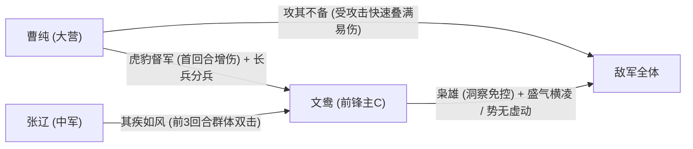
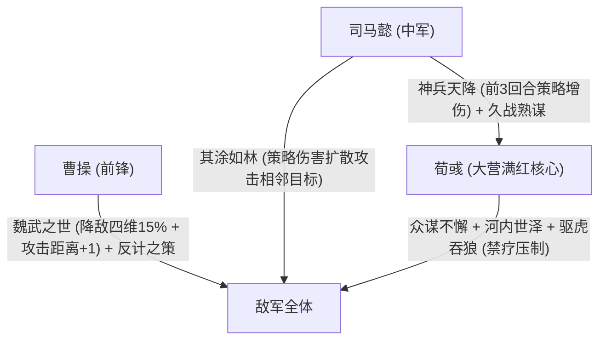

# 主城主力五队配置指南

> 说明：
> 1. 本文档记录账号核心主城主力五队（主力体系阵容）的完整战法、宝物、兵种特性及配点方案。
> 2. 阵容数据来源于游戏内实际配将截图，红度以数字（`0 ~ 5`）表示。
> 3. 目前已录入前两队（部队 1：文鸯曹纯魏骑菜刀，部队 2：神赏大魏智法刀），后续三队待实装后持续补充。

---

## 一、 主城五队总览矩阵表

| 队伍序号与定位 | 位置 | 武将 | 红度 | 阵营 | Cost | 兵种与转职 | 自带战法 | 战法二 | 战法三 | 装备宝物 (词条) | 兵种特性 | 加点与战术备注 |
| :--- | :---: | :--- | :---: | :---: | :---: | :--- | :--- | :--- | :--- | :--- | :--- | :--- |
| **第一队 魏骑菜刀** (总Cost: 10.0) | **大营** | **曹纯 (S3)** | 0 | 魏 | 3.0 | 重骑兵 | 【虎豹督军】(A) | 【攻其不备】(S) | 【长兵方阵】(B) | 极·冥山勾月 (词条：坚忍) | 出奇 · 疾行 | **全攻击** 首回合增伤拉满，快速叠满攻其不备 |
| ^ | **中军** | **张辽** | 3 | 魏 | 3.5 | 重骑兵 | 【其疾如风】(S) | 【威震逍遥】(A) | 【乘胜追击】(S) | 极·屈卢 (词条：无畏) | 扰后 · 疾行 | **全攻击**（马工张辽） 全队连击发动机，补充前中期物理输出 |
| ^ | **前锋** | **文鸯 (XP)** | 1 | 魏 (转阵营) | 3.5 | 轻骑兵 | 【盛气横凌】(S) | 【枭雄】(B) | 【势无虚动】(A) | 极·元戎 (词条：骁锐) | 扰后 · 疾行 | **全攻击**（核心主C） 免控爆发，借张辽连击高频触发追击 |
| **第二队 神赏大魏智** (总Cost: 10.0) | **大营** | **荀彧** | 5 | 魏 | 3.0 | 轻骑兵 | 【驱虎吞狼】(S) | 【众谋不懈】(S) | 【河内世泽】(S) | 极·涂氏匕首 (词条：筹算) | 扰后 · 疾行 | **全谋略** 满红大核，高频双主动触发众谋与禁疗压制 |
| ^ | **中军** | **司马懿 (XP)** | 0 | 魏 (转阵营) | 3.5 | 禁卫/重步 | 【其涂如林】(S) | 【久战熟谋】(A) | 【神兵天降】(S) | 极·鸣鸿 (词条：天资) | 勇毅 · 守备 | **全谋略** 神兵大赏核心增伤工具人，附带扩散策略伤害 |
| ^ | **前锋** | **曹操** | 1 | 魏 | 3.5 | 重骑兵 | 【魏武之世】(S) | 【单骑救主】(A) | 【反计之策】(S) | 极·大将 (词条：沉稳) | 难测 · 出奇 | **全防御** 压制敌方全属性与大营攻击距离，双控防暴毙 |
| **第三队** (待补充) | **大营** | 待补充 | - | - | - | - | - | - | - | - | - | 待实装补充 |
| ^ | **中军** | 待补充 | - | - | - | - | - | - | - | - | - | 待实装补充 |
| ^ | **前锋** | 待补充 | - | - | - | - | - | - | - | - | - | 待实装补充 |
| **第四队** (待补充) | **大营** | 待补充 | - | - | - | - | - | - | - | - | - | 待实装补充 |
| ^ | **中军** | 待补充 | - | - | - | - | - | - | - | - | - | 待实装补充 |
| ^ | **前锋** | 待补充 | - | - | - | - | - | - | - | - | - | 待实装补充 |
| **第五队** (待补充) | **大营** | 待补充 | - | - | - | - | - | - | - | - | - | 待实装补充 |
| ^ | **中军** | 待补充 | - | - | - | - | - | - | - | - | - | 待实装补充 |
| ^ | **前锋** | 待补充 | - | - | - | - | - | - | - | - | - | 待实装补充 |

---

## 二、 部队 1：魏骑菜刀队（曹纯 + 张辽 + 文鸯）深度解析

### 1. 阵容机制与战术逻辑
- **核心定位**：极速爆发物理菜刀队，专为撕裂无规避或减伤薄弱的前锋中军设计。
- **阵营加成**：通过赛季阵营转换特性将 **晋·文鸯 转为 魏阵营**，全队激活 10% 魏骑阵营属性与兵种加成，契合度拉满。
- **免控爆发**：文鸯携带【枭雄】获得洞察免控，彻底破除战必断金、反计犹豫及怯战控制，配合张辽【其疾如风】的双击机制与【势无虚动】，在首回合曹纯【虎豹督军】攻击增伤窗口期内打出毁天灭地的爆发伤害。
- **攻其不备极速叠层**：曹纯携带【长兵方阵】，配合张辽的全军两次普攻与追击战法，能在第 1 回合内快速打满【攻其不备】的 5 层最高增伤。

### 2. 宝物与词条契合度
- **曹纯 ➔ 极·冥山勾月（坚忍）**：增强肉度与主动抗性，稳固前锋中军血线。
- **张辽 ➔ 极·屈卢（无畏）**：骁锐攻击 + 无畏追击增伤 + 破敌无视 10% 防御，全面增强张辽追击伤害。
- **文鸯 ➔ 极·元戎（骁锐）**：普通攻击增伤 + 追击伤害提高 + 迸发追击额外选取目标，配合文鸯高频追击实现群体压制。

### 3. 特性与配点方案
- **配点方案**：全队 **全攻击** 加点（张辽作为马工工具人与副C同时全攻），速度依靠【疾行】特性与张辽自带战法拉开优先出手权。
- **实战禁忌**：原图明确备注 **“避开百战体系”**，面对严颜百战肉步或高减伤垒石体系时尽量避开正面对撞，优先打击法刀、法骑与流氓队。

---

## 三、 部队 2：神赏大魏智（荀彧 + 司马懿 + 曹操）深度解析

### 1. 阵容机制与战术逻辑
- **核心定位**：神赏体系变种策略高爆发队，具备全图禁疗、大营手长压制与扩散策略打击。
- **阵营转换**：中军 **晋·司马懿 转为 魏阵营**，全队 3 名武将阵营完全统一为魏，吃到 10% 魏阵营加成。
- **属性碾压（魏武之世）**：曹操自带【魏武之世】开局直接削减敌军全体 15% 攻、防、谋、速（受谋略影响实战削减更高），此消彼长之下荀彧与司马懿谋略差达到极致，同时为全队攻击距离 +1，解放普攻站位。
- **多段爆发触发链**：荀彧 5 红满阶，携带【众谋不懈】与【河内世泽】，每回合行动时试图发动双主动战法即有极高概率触发【众谋不懈】神兵增伤单点轰杀，配合【驱虎吞狼】实现 100% 禁疗。
- **伤害扩散（其涂如林）**：司马懿【其涂如林】使荀彧与司马懿造成的所有策略伤害在生效时，额外对相邻敌军进行比例扩散打击，形成大面积轰炸。

### 2. 宝物与词条契合度
- **荀彧 ➔ 极·涂氏匕首（筹算）**：攻击谋略 +5.0%，筹算使主动策略主战法发动率提高 11.0%，大幅提升【驱虎吞狼】发动期望。
- **司马懿 ➔ 极·鸣鸿（天资）**：防御 +3.0，主战法伤害 +10.0%，天资谋略 +6.0%，补足白板司马懿的谋略面板。
- **曹操 ➔ 极·大将（沉稳）**：防御属性提高，援护大营荀彧，并大幅降低自身受到的指挥战法伤害，稳固前锋承伤底线。

### 3. 特性与配点方案
- **配点方案**：原图明确备注 **“谋谋防”**（荀彧全谋、司马懿全谋、曹操全防）。
- **调速细节**：司马懿需保证速度快于荀彧出手，使【神兵天降】增伤与【其涂如林】扩散机制提前铺垫生效。

---

## 四、 后续主力补全规划（预留 3、4、5 队）

当前账号五队构建已锁定两队高红核心体系：
1. **已就绪**：第一队 · 魏骑菜刀（文鸯张辽曹纯）—— 物理击溃位。
2. **已就绪**：第二队 · 神赏大魏智（荀彧司马懿曹操）—— 法术爆发位。
3. **待实装**：第三队、第四队、第五队将根据后续上传的阵容截图（如肉步/蜀步、孙权法刀/吴弓、流氓队等）实时录入。
