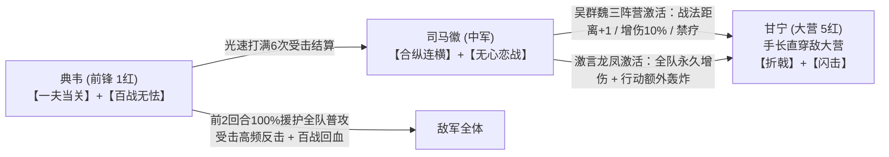
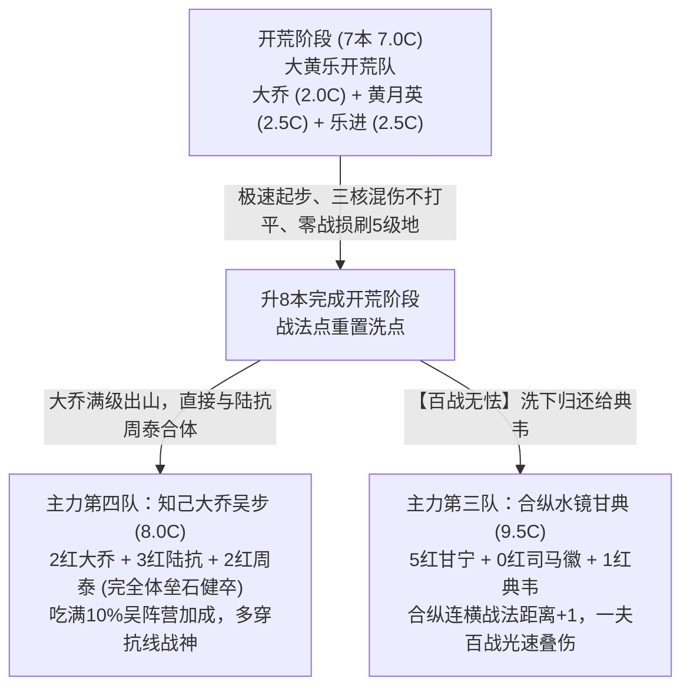
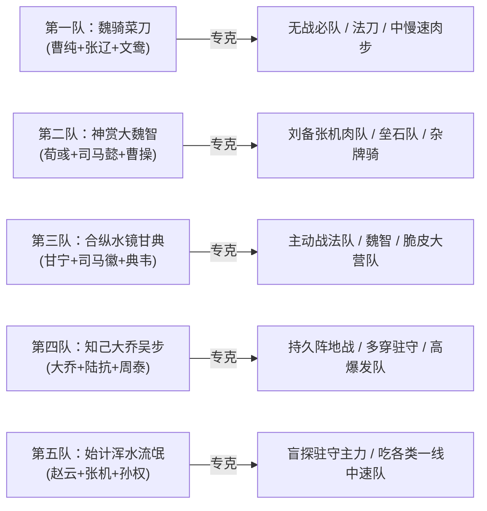

# 主城主力五队配置指南

> 说明：
> 1. 本文档记录账号核心主城主力五队（主力体系阵容）的完整战法、宝物、兵种特性及配点方案。
> 2. 阵容数据来源于游戏内实际配将与仓库资源，红度以数字（`0 ~ 5`）表示。
> 3. 全局五队经过严格校验，**武将、战法、极品宝物均实现 100% 独立配置，零冲突**。
> 4. 开荒采用 **大乔 + 黄月英 + 乐进（7.0C 大黄乐）** 极速起步，8本直接无痛转型第四队（知己大乔吴步）。
> 5. 第三队实装【合纵连横】三阵营黑科技，成功解放顶级神技【垒石迎击】交由第四队周泰佩戴，达成双队顶配。

---

## 一、 主城五队总览矩阵表

| 队伍序号与定位 | 位置 | 武将 | 红度 | 阵营 | Cost | 兵种与转职 | 自带战法 | 战法二 | 战法三 | 装备宝物 (词条) | 兵种特性 | 加点与战术备注 |
| :--- | :---: | :--- | :---: | :---: | :---: | :--- | :--- | :--- | :--- | :--- | :--- | :--- |
| **第一队 魏骑菜刀** (总Cost: 10.0) | **大营** | **曹纯 (S3)** | 0 | 魏 | 3.0 | 重骑兵 | 【虎豹督军】(A) | 【攻其不备】(S) | 【长兵方阵】(B) | 极·冥山勾月 (词条：坚忍) | 出奇 · 疾行 | **全攻击** 首回合增伤拉满，快速叠满攻其不备 |
| ^ | **中军** | **张辽** | 3 | 魏 | 3.5 | 重骑兵 | 【其疾如风】(S) | 【威震逍遥】(A) | 【乘胜追击】(S) | 极·屈卢 (词条：无畏) | 扰后 · 疾行 | **全攻击**（马工张辽） 全队连击发动机，补充前中期物理输出 |
| ^ | **前锋** | **文鸯 (XP)** | 1 | 魏 (转阵营) | 3.5 | 轻骑兵 | 【盛气横凌】(S) | 【枭雄】(B) | 【势无虚动】(A) | 极·元戎 (词条：骁锐) | 扰后 · 疾行 | **全攻击**（核心主C） 免控爆发，借张辽连击高频触发追击 |
| **第二队 神赏大魏智** (总Cost: 10.0) | **大营** | **荀彧** | 5 | 魏 | 3.0 | 轻骑兵 | 【驱虎吞狼】(S) | 【众谋不懈】(S) | 【河内世泽】(S) | 极·涂氏匕首 (词条：筹算) | 扰后 · 疾行 | **全谋略** 满红大核，高频双主动触发众谋与禁疗压制 |
| ^ | **中军** | **司马懿 (XP)** | 0 | 魏 (转阵营) | 3.5 | 禁卫/重步 | 【其涂如林】(S) | 【久战熟谋】(A) | 【神兵天降】(S) | 极·鸣鸿 (词条：天资) | 勇毅 · 守备 | **全谋略** 神兵大赏核心增伤工具人，附带扩散策略伤害 |
| ^ | **前锋** | **曹操** | 1 | 魏 | 3.5 | 重骑兵 | 【魏武之世】(S) | 【单骑救主】(A) | 【反计之策】(S) | 极·大将 (词条：沉稳) | 难测 · 出奇 | **全防御** 压制敌方全属性与大营攻击距离，双控防暴毙 |
| **第三队 合纵水镜甘典** (总Cost: 9.5) | **大营** | **甘宁** | 5 | 吴 | 3.5 | 重步兵 | 【侵掠如火】(S) | 【闪击】(B) | 【折戟强攻】(A) | 极·真刚 (词条：盛气+骁锐) | 勇毅 · 列阵 | **全攻击**（核心输出） 吃【合纵连横】战法距离+1直穿大营，闪击70%极速垫刀，真刚前2回合+20%攻伤爆发 |
| ^ | **中军** | **司马徽** | 0 | 群 | 3.0 | 禁卫/重步 | 【激言龙凤】(S) | 【合纵连横】(S) | 【无心恋战】(S) | 极·仁风 (词条：天资+灵动) | 守备 · 勇毅 | **全谋略**（核心发动机） 完美触发吴群魏三阵营合纵，距离+1、增伤10%、普攻禁疗；无心前3回合大幅压制敌军 |
| ^ | **前锋** | **典韦** | 1 | 魏 | 3.0 | 重步兵 | 【舍身卫主】(S) | 【百战无怯】(S) | 【一夫当关】(S) | 极·大橹 (词条：避险+稳固) | 守备 · 固阵 | **全防御**（承伤反击核心） 前2回合一夫100%援护吸普攻，配合百战回血+自带反击，光速叠满司马徽6次伤害 |
| **第四队 知己大乔吴步** (总Cost: 8.0) | **大营** | **大乔** | 2 | 吴 | 2.0 | 弓兵/弩兵 | 【巧音唤蝶】(S) | 【兵无常势】(S) | 【十面埋伏】(S) | 极·游飘 (词条：双颖悟) | 扰后 · 齐射 | **全谋略**（开荒转主C） 大黄乐开荒满级出山，瞬发轰炸兼急救抬血，双颖悟无视22%谋略 |
| ^ | **中军** | **陆抗** | 3 | 吴 | 3.0 | 重步兵 | 【西陵克晋】(S) | 【知己知彼】(S) | 【桃园结义】(S) | 极·承影 (词条：天资+机先) | 守备 · 固阵 | **全谋略**（核心增益） 指挥双动极速叠满知己知彼80%增易伤，桃园后手援护补伤 |
| ^ | **前锋** | **周泰** | 2 | 吴 | 3.0 | 重步兵 | 【疮痍累身】(S) | **【垒石迎击】(S)** | **【健卒不殆】(S)** | 极·博浪(二) (词条：抖擞+坚忍) | 利刃 · 守备 | **全防御**（完全体终极肉盾） 典韦解放出【垒石+健卒】完全体，挨打无限叠攻防谋+解控规避反击，后期战神 |
| **第五队 始计浑水流氓队** (总Cost: 9.0) | **大营** | **赵云** | 2 | 蜀 | 3.0 | 长枪兵 | 【银龙冲阵】(S) | 【一骑当千】(S) | 【人中吕布】(S) | 极·彤素 (词条：英勇+奇袭) | 列阵 · 近战 | **全攻击**（物理大核） 配彤素61%瞬发破防挂易伤，吃始计增伤一骑+人中毁天灭地 |
| ^ | **中军** | **张机** | 1 | 汉 | 3.0 | 弩兵 | 【金匮要略】(S) | **【避其锋芒】(S)** | 【重整旗鼓】(S) | 极·博浪(一) (词条：抖擞+仁心) | 迂回 · 地利 | **全谋略**（防御基石） 前3回合高额双减伤+受击急救，5回合后重整大抬血，构建铁桶防线 |
| ^ | **前锋** | **孙权** | 0 | 吴 | 3.0 | 死士 | 【九锡黄龙】(S) | 【始计】(S) | 【浑水摸鱼】(S) | 极·别鸣 (词条：英才+机敏) | 迂回 · 地利 | **全谋略**（解控强控） 始计洞察免控保浑水摸鱼必出，九锡黄龙全队解负面+提供两次绝对规避 |

---

## 二、 部队 3：合纵水镜甘典（甘宁 + 司马徽 + 典韦）联动机制解析

### 1. 战术特色与克制定位
* **三阵营合纵连横**：甘宁（吴）+ 司马徽（群）+ 典韦（魏），完美触发【合纵连横】的战法距离 +1。大营甘宁的【折戟强攻】与【闪击】直接覆盖敌军全体三目标，典韦反击距离提升至 3。
* **一夫百战极速吸火**：前 2 回合典韦【一夫当关】强制援护全队普攻，一边吃高额物理减伤，一边利用受击触发【百战无怯】回血 200%，同时高频反击，第 1 回合即可打满司马徽【激言龙凤】的 6 次受击前置条件。
* **专克主动战法队与魏智**：甘宁配【极·真刚】前 2 回合提升 20% 攻击伤害，配合勇毅降低受到的策略伤害，专打前锋薄弱的主动战法队伍及中速法系队伍。

---

## 三、 赛季开荒与极速转型规划（大黄乐体系）

### 1. 开荒期（7本 7.0 Cost）
* **大营：大乔 (2.0C)** —— 【兵无常势】（或前期带河内世泽暂用）
* **中军：黄月英 (2.5C)** —— 【磐阵善守】 / 【战必断金】
* **前锋：乐进 (2.5C)** —— **【百战无怯】**（暂时从主力典韦借调）
* **优势**：7本直接合体出山，三核输出绝不打平，受野怪暴走影响小，**大乔吃满所有升级经验，满级（35~40级）完成开荒出山**。

### 2. 转型期（8本 8.0 Cost）
* **第四队（知己大乔吴步）**：大乔（2.0C）直接与练兵所练至 20 级的 **3红陆抗（3.0C）**、**2红周泰（3.0C）** 合体，**总 Cost 恰好 8.0C，无需升级帅令坛**，周泰正式装配 **【垒石迎击】+【健卒不殆】完全体**，直接成型开战！
* **第三队（合纵水镜甘典）**：将乐进的【百战无怯】洗下，正式交还给 **1红典韦**，配上【一夫当关】，第三队主力同时满配出战。

---

## 四、 全局五队战术分工与战法宝物 0 冲突校验

### 战法与宝物 100% 独立配置核对表
1. **减伤与指挥体系分流**：
   * 神兵天降 + 反计之策 ➔ **第二队（大魏智）**
   * 攻其不备 + 长兵方阵 ➔ **第一队（魏骑菜刀）**
   * 合纵连横 + 无心恋战 ➔ **第三队（水镜甘典）**
   * 知己知彼 + 桃园结义 ➔ **第四队（大乔吴步）**
   * 避其锋芒 + 始计浑水 ➔ **第五队（赵云流氓）**
2. **核心防御战法分流**：
   * 单骑救主 ➔ 第二队（曹操）
   * 百战无怯 + 一夫当关 ➔ 第三队（典韦）
   * 垒石迎击 + 健卒不殆 ➔ 第四队（周泰 · 完全体）
   * 兵无常势 ➔ 第四队（大乔）
   * 重整旗鼓 ➔ 第五队（张机）
3. **极品宝物对号入座**：
   * 冥山勾月（曹纯）、屈卢（张辽）、元戎（文鸯）
   * 涂氏匕首（荀彧）、鸣鸿（司马懿）、大将（曹操）
   * 真刚（甘宁 · 盛气）、仁风（司马徽）、大橹（典韦）
   * 游飘（大乔 · 双颖悟）、承影（陆抗）、博浪坚忍（周泰）
   * 彤素（赵云 · 英勇奇袭）、博浪仁心（张机）、别鸣（孙权）
